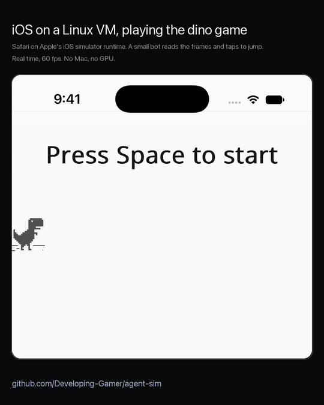

# agent-sim

**iOS simulators for AI agents, on ordinary Linux machines.** No Mac, no GPU.

<p align="center"></p>

<p align="center">Safari on Apple's iOS runtime, on a Linux VM, recorded at 60 fps (the GIF is 15).
<a href="https://github.com/Developing-Gamer/agent-sim/releases/download/v0.1.0/dino.mp4">Full clip</a> ·
<a href="https://github.com/Developing-Gamer/agent-sim/releases/download/v0.1.0/agent-sim-demo.mp4">An agent driving
Settings and Safari</a></p>

agent-sim runs Apple's iOS simulator runtime on an x86-64 Linux VM and gives agents what they need to test iOS
apps: install an `.ipa`, read the screen as text, tap, type, scroll, and watch it live in a browser. One command line
for scripts and CI, and an MCP server for Claude Code, Cursor, Codex and other agents.

```
$ agent-sim launch com.apple.Preferences && agent-sim snapshot
app com.apple.Preferences
@e1 button "Apple Account, Sign in to access your iCloud data, the App Store, Apple services, and more." (201,213)
@e2 button "General" id="com.apple.settings.general" (201,320)
@e3 button "Accessibility" id="com.apple.settings.accessibility" (201,372)
...
$ agent-sim tap @e2
tapped @e2 button "General"
```

> **Status: early.** It works end to end; expect rough edges, and see [what does not work yet](docs/KNOWN_ISSUES.md).

## iOS tests on arm64 Linux, natively

This fork's `arm64` branch runs Apple's arm64 iOS simulator runtime **natively on arm64 Linux**: no translator, the
runtime's own code on the CPU, under Darling with [patches/darling-arm64](patches/darling-arm64). It is the iOS
platform of a CI and agent setup that builds iOS apps on Linux with
[rules_applecross](https://github.com/apple-cross-toolchain/rules_applecross) and tests them here: agent-sim picks up
where rules_applecross leaves off. [docs/ARM64.md](docs/ARM64.md) has the details.

What works today, on iOS 27.2 (24B8117) in an arm64 Linux container (Ubuntu 24.04 or 26.04):

- **The phone:** `agent-sim phones up N` boots N iPhone 17s to the home screen; apps install, launch and draw
  (Metal through x86Sim's Vulkan stand-in, on the CPU), and `screenshot`, `tap`, `swipe`, `type` and `press` drive
  them.
- **XCTest:** logic tests, app-hosted unit tests and UI tests (XCUITest), with XCTest's frameworks taken from the same
  Xcode .xip the bundles were built against. `agent-sim xctest` runs a bundle on a free phone and writes JUnit.
- **`bazel test`:** `bazel/` is a test runner for rules_apple's `ios_unit_test` and `ios_ui_test`
  (`runner = "@agent_sim_rules//:ios_runner"`), so `bazel test //...` builds the bundles on Linux and runs them on
  the phones.
- **`xcrun simctl`** for scripts written for a Mac: the verbs CI scripts and Bazel launchers use (create, boot,
  install, launch, `io screenshot`, `status_bar`, `ui appearance`, ...). Visor's iOS screenshot proof, written for a
  Mac, runs on Linux through it (with fallbacks for `ditto` and `sips`), and most of its pictures are
  pixel-identical to a Mac's. `launchctl procinfo <pid>` says whether iOS has suspended a phone's process, as a Mac's
  does for its simulators.

Its limits, today:

- A phone needs two to three minutes to boot (every boot; [docs/ARM64.md](docs/ARM64.md) has why) and about 2.6 GB
  of memory with an app running. Drawing is in software, so animations are slower than on a Mac.
- Only iOS 27.2 and the iPhone 17 are tried; no device builds, no push, no Apple services.
- An app crashes now and then on a phone's first boot (about one UI test run in eight); `--flaky_test_attempts=2`
  covers it.

### Building test bundles on Linux

rules_applecross builds the app and its test bundles on Linux from an Xcode .xip; agent-sim runs them.
[tests/apps/XCTestDemo](tests/apps/XCTestDemo) is a complete example workspace: its `MODULE.bazel` brings in
rules_apple, rules_applecross and agent-sim's runner, and its `BUILD.bazel` has a logic test, a hosted unit test and
a UI test.

```sh
cd tests/apps/XCTestDemo
printf 'build --distdir=%s\ncommon --repo_env=CC=clang\n' ~/xcode > .bazelrc.user   # ~/xcode holds Xcode_27.2.xip
agent-sim phones up 2
bazel test --test_env=AGENT_SIM_EXPECT=$PWD/expected.txt //...   # its sources fail and skip some tests on purpose
```

### Not clean-room

rules_applecross is clean-room: it builds Apple bundles without Apple's tools, and nothing in it comes from looking
inside Apple's binaries. agent-sim is not, and is kept apart from it. To run Apple's simulator runtime it reads that
runtime's own interfaces (class and method names, the messages it logs) and patches around what Linux lacks. The
simulator never ships anywhere; only the bundles rules_applecross builds do. Apple's runtime and Xcode are fetched
onto your machine and are never part of this repository.

## Quick start

On an x86-64 Linux machine with Ubuntu 24.04 (8+ CPUs, 16 GB of memory, 60 GB of free disk):

```sh
curl -fsSL https://raw.githubusercontent.com/Developing-Gamer/agent-sim/main/install.sh | bash
agent-sim setup      # once, about half an hour: x86Sim, Apple's iOS runtime (8 GB, from Apple), a first phone
agent-sim up         # boot it: 12-30 s, depending on the CPU
agent-sim snapshot
```

From a checkout instead: `cargo build --release`, then `scripts/setup-vm.sh` and `target/release/agent-sim`.

`agent-sim setup --fidelity high --device hifi` adds a phone that looks exactly like Apple's simulator (3x, every
blur and animation) for screenshots; the default draws at 2x with reduced effects and scrolls twice as fast.

## Use it from an agent

As an MCP server:

```sh
claude mcp add agent-sim -- agent-sim mcp          # Claude Code
```

```json
{ "mcpServers": { "agent-sim": { "command": "agent-sim", "args": ["mcp"] } } }
```

An agent on another machine (your laptop) runs the same server over SSH; MCP's stdio passes through unchanged:

```sh
claude mcp add agent-sim -- ssh my-linux-vm agent-sim mcp
```

The tools are `snapshot`, `tap`, `type`, `scroll`, `swipe`, `press`, `launch`, `terminate`, `install`,
`uninstall`, `apps`, `open_url`, `wait_for`, `screenshot` and `boot`. Actions answer with the screen that follows,
so an agent sees the result of each step without asking again. For agents that work in a shell,
[skills/agent-sim/SKILL.md](skills/agent-sim/SKILL.md) teaches the command line.

## The command line

```sh
agent-sim install MyApp.ipa        # a device build is converted for the simulator; a simulator .app works too
agent-sim launch com.example.myapp
agent-sim snapshot                 # the screen as text, one element per line (--json for frames, ids, states)
agent-sim tap @e4                  # an element from the last snapshot; or: tap "Sign in"; or: tap 201 320
agent-sim type "hello@example.com"
agent-sim scroll down
agent-sim wait "Welcome" --timeout 20
agent-sim screenshot -o screen.png
agent-sim press home
agent-sim open https://example.com
```

`snapshot` reads the accessibility tree of the app in front, the web pages it shows, and SpringBoard, so system
alerts, the home screen and the status bar are in it too. Every command takes `--device NAME`; `agent-sim --help`
lists them all.

The simulator controls Apple's `simctl` has are here too: `appearance dark`, `status-bar --time 9:41`, `clipboard`,
`record -o video.mp4`, `erase`, `logs`, plus x86Sim's `location`, `push`, `privacy` and `addmedia`.
[docs/PARITY.md](docs/PARITY.md) compares every feature with Apple's Simulator on a Mac.

Device builds run when they are not encrypted. App Store downloads are (FairPlay), so use an Ad Hoc, Development or
Enterprise export, or build for the simulator.

## Watch it in a browser

```sh
agent-sim serve --listen 0.0.0.0:7979
```

It prints a URL with an access token. The page streams the screen as H.264 over a WebSocket (decoded with
WebCodecs, so a recent Chrome, Edge or Safari) and sends touches, keys, scrolling and the Home and Lock buttons
back. Touches that start at a screen edge are system gestures: a swipe up from the bottom goes home. Keep the token
private.

## Many phones

```sh
agent-sim pool up 3                # prepare and boot pool1..pool3
phone=$(agent-sim pool take)       # a booted phone nobody else holds
agent-sim --device "$phone" snapshot
agent-sim pool release "$phone"    # it restarts in the background for the next taker
```

Phones share memory through the kernel's KSM: three take 6.8 GB together instead of 8.7 GB. On a cloud provider
with VM memory snapshots, a booted phone can be saved and brought back running in about 20 seconds
([docs/BENCHMARKS.md](docs/BENCHMARKS.md)).

## How it works

[x86Sim](https://github.com/x86sim/x86sim) runs Apple's arm64 simulator runtime on x86-64 Linux: Darling provides
the macOS kernel interfaces, dynarmic translates the ARM code, and Mesa's CPU Vulkan driver draws Metal through
metal2vulkan. agent-sim builds the agent-facing product on top of it:

- **A phone set up for speed:** a pre-translated runtime, the services apps need and none they do not, the screen
  drawn at 2x, and reduced transparency and motion. Scrolling runs at about 55 fps on a Zen 5 VM, and a touch
  reaches the screen in about 14 ms ([docs/BENCHMARKS.md](docs/BENCHMARKS.md)).
- **Fixes in x86Sim** ([patches/x86sim](patches/x86sim)): web workers in Safari, and apps with crash reporters
  no longer crawl.
- **Hooks in the phone** ([hooks](hooks)): an accessibility reader for `snapshot`, and stale permission prompts
  dismissed as on a device.
- **The agent interface:** the CLI, the MCP server, `.ipa` conversion, the phone pool and the browser stream.

## Documentation

- [docs/PARITY.md](docs/PARITY.md): feature by feature against Apple's Simulator on a Mac
- [docs/BENCHMARKS.md](docs/BENCHMARKS.md): speed, memory, several phones, snapshots
- [docs/KNOWN_ISSUES.md](docs/KNOWN_ISSUES.md): what does not work yet and why
- [docs/ROADMAP.md](docs/ROADMAP.md): what comes next
- [docs/ARM64.md](docs/ARM64.md): the runtime natively on arm64 Linux, no translator (work in progress)
- [CONTRIBUTING.md](CONTRIBUTING.md) and [SECURITY.md](SECURITY.md)

## Credits

agent-sim builds on [x86Sim](https://github.com/x86sim/x86sim), which runs Apple's simulator runtimes on Linux
through [Darling](https://github.com/darlinghq/darling), [dynarmic](https://github.com/azahar-emu/dynarmic) and
[metal2vulkan](https://github.com/steelbrain/metal2vulkan). Fixes agent-sim needs in x86Sim itself live in
[patches/x86sim](patches/x86sim) until they are upstream.

Apple's runtimes are downloaded from Apple onto your own machine and are never part of this repository.

## License

[Apache-2.0](LICENSE), except the patches in `patches/x86sim`, which follow x86Sim's GPL-3.0-or-later, and those in
`patches/darling-arm64`, which follow Darling's and x86Sim's licenses.
